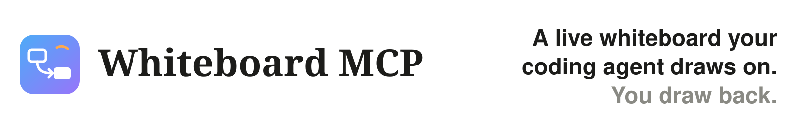
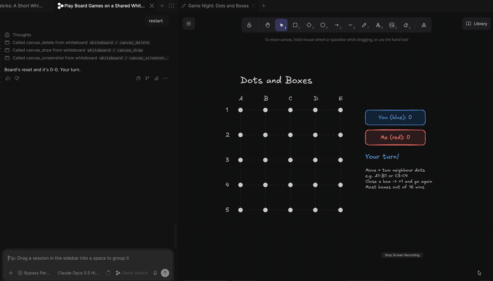
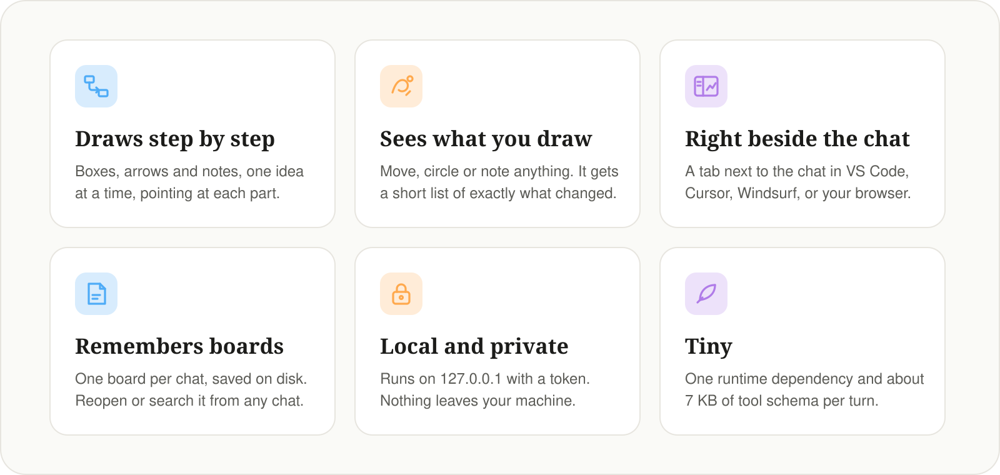
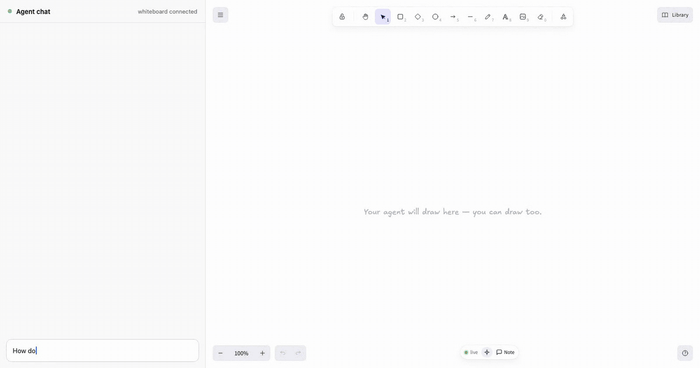
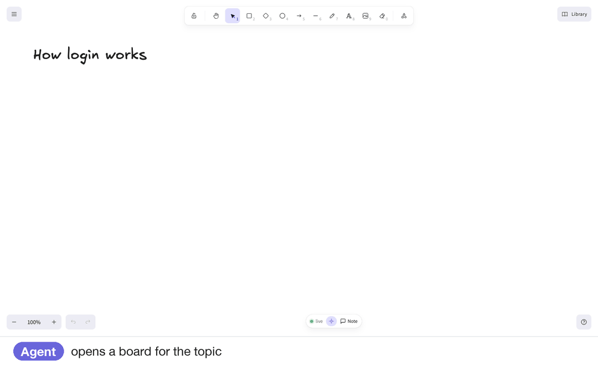
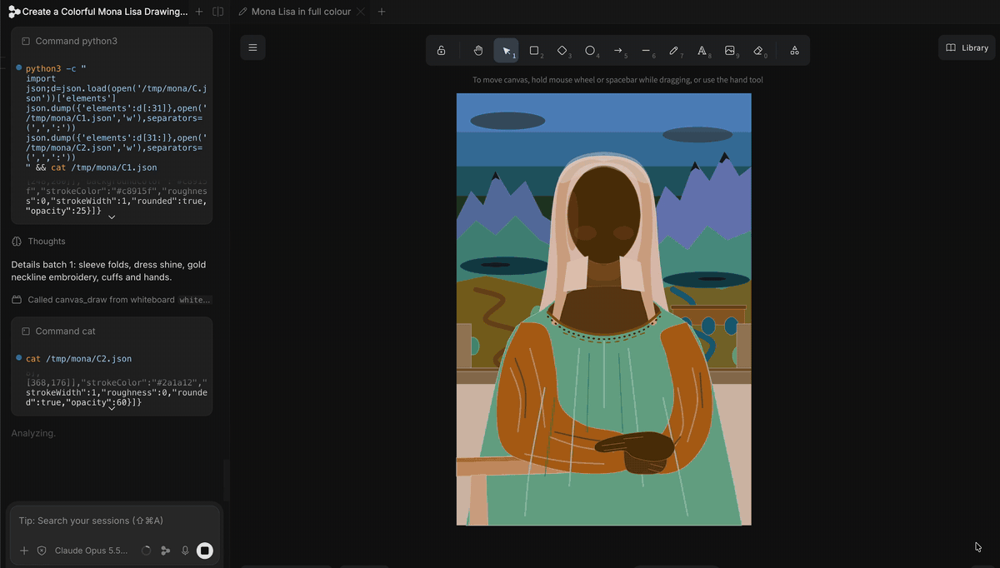
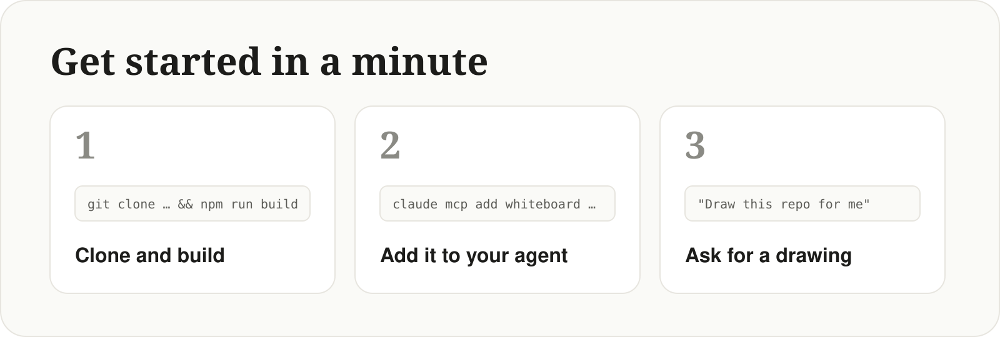
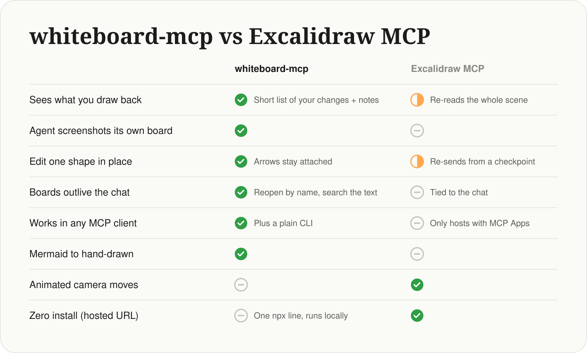

<a href="#quick-start">
  <picture>
    <source media="(prefers-color-scheme: dark)" srcset="docs/media/readme/hero-dark.svg">
    
  </picture>
</a>

<p align="center"><b>Whiteboard MCP</b> is a free, open-source <b>Excalidraw whiteboard MCP server</b> that runs locally, even offline. Your coding agent draws diagrams on a live board beside the chat, and sees what you draw back. Works with Claude Code, Codex, Cursor, Gemini CLI, VS Code, Windsurf, Devin and any other MCP client.</p>

```sh
claude mcp add whiteboard --scope user -- npx -y @ansuman-shukla/whiteboard-mcp
```

<p align="center"><sub>Needs Node.js 20+. Using Codex, Cursor, Gemini CLI, VS Code or another agent? <a href="#add-it-to-your-agent">Commands for every agent ↓</a></sub></p>

<br>



<p align="center"><sub>Playing Dots and Boxes with an agent: you draw a line, it sees your move and plays back.</sub></p>

## Features

<picture>
  <source media="(prefers-color-scheme: dark)" srcset="docs/media/readme/features-dark.svg">
  
</picture>

## What you can do with it

### Understand an architecture

*"How does a typical checkout backend work? Draw it on the whiteboard."* The agent draws it piece by piece and highlights what it's explaining. You move a box, circle the part you're unsure about and leave a note. It reads exactly what you changed and answers on the board.



### Explain a flow

*"How does login work here?"* Arrows stay attached as things move, and the agent answers your notes on its next look.



### Make something

*"Paint the Mona Lisa, then refine it with the pencil."* Shapes, freehand strokes and frames, all editable.



### More to try

- *"Explain how a request flows through this repo, on the whiteboard."*
- *"Teach me how a TCP handshake works, step by step."*
- *"Draw our deploy pipeline and mark the single points of failure."*
- *"Compare option A and option B side by side on the board."*
- *"I circled something on the board, take a look."*

## Quick start

<picture>
  <source media="(prefers-color-scheme: dark)" srcset="docs/media/readme/steps-dark.svg">
  
</picture>

### Add it to your agent

Needs Node.js 20+. Add it, then start a new chat:

```sh
# Claude Code
claude mcp add whiteboard --scope user -- npx -y @ansuman-shukla/whiteboard-mcp

# Codex CLI
codex mcp add whiteboard -- npx -y @ansuman-shukla/whiteboard-mcp

# Gemini CLI
gemini mcp add --scope user whiteboard npx -y @ansuman-shukla/whiteboard-mcp

# Devin CLI
devin mcp add whiteboard --scope user -- npx -y @ansuman-shukla/whiteboard-mcp

# VS Code
code --add-mcp '{"name":"whiteboard","command":"npx","args":["-y","@ansuman-shukla/whiteboard-mcp"]}'
```

**Cursor, Claude Desktop, Windsurf and other JSON configs** (`~/.cursor/mcp.json`, Claude Desktop's config, …):

```json
{ "mcpServers": { "whiteboard": { "command": "npx", "args": ["-y", "@ansuman-shukla/whiteboard-mcp"] } } }
```

**OpenCode** (`opencode.json`):

```json
{ "mcp": { "whiteboard": { "type": "local", "command": ["npx", "-y", "@ansuman-shukla/whiteboard-mcp"] } } }
```

Agents without MCP, project-level configs and more: [client setup](docs/clients.md). For boards in a tab beside the chat, install the [IDE panel](docs/ide-panel.md). The bundled [skill](docs/clients.md#the-skill-recommended-for-every-agent) teaches the agent when a drawing helps.

## Whiteboard MCP vs Excalidraw MCP

<a href="docs/comparison.md">
  <picture>
    <source media="(prefers-color-scheme: dark)" srcset="docs/media/readme/compare-dark.svg">
    
  </picture>
</a>

<p align="center"><sub>Want a quick one-off diagram inside Claude or ChatGPT on the web? Excalidraw MCP is great for that. <a href="docs/comparison.md">Full comparison →</a></sub></p>

## FAQ

### Is there an Excalidraw MCP server that runs locally and works offline?

Yes, that's Whiteboard MCP. It runs a small daemon on `127.0.0.1` and serves the Excalidraw viewer with its fonts bundled. After the first `npx` download it needs no internet, no account and no API key. Boards are plain JSON files in `~/.whiteboard-mcp`.

### How do I let Claude Code, Codex or Cursor draw diagrams?

Add the MCP server with the one-line command for your agent [above](#add-it-to-your-agent), start a new chat and ask: *"Draw how this repo handles a request on the whiteboard."* The agent draws step by step on a live Excalidraw board beside the chat.

### Can the agent see what I draw on the whiteboard?

Yes. Every time it looks, it gets a short list of what you added, moved or deleted, plus any notes you left. It can also take a PNG screenshot of the board to check its own layout.

### Which agents and editors does it work with?

Any MCP client: Claude Code, Claude Desktop, OpenAI Codex, Cursor, Gemini CLI, VS Code (Copilot agent mode), Windsurf, Devin, OpenCode and more. Agents without MCP can use the plain `whiteboard-mcp call` CLI. The [IDE panel](docs/ide-panel.md) shows boards in a tab beside the chat in VS Code, Cursor, Windsurf and Devin Desktop; chat apps that support [MCP Apps](docs/inline.md) show them inline in the conversation; anywhere else they open in your browser.

### Can it turn Mermaid into an Excalidraw diagram, or export it?

Yes. `canvas_mermaid` converts Mermaid (flowcharts, sequence diagrams, …) into editable hand-drawn elements, and `canvas_export` saves the board as `.excalidraw` or `.png` in your project.

### Are boards saved? Can I reopen one later?

Each chat gets its own board, saved on disk. Any later chat, even in another folder, can reopen it by name or find it by the text on it, and you can keep frozen copies in a saved library. See [boards](docs/boards.md).

### Is it free and private?

Yes. It's MIT licensed with no license key or paid tier. Everything stays on your machine: the daemon only listens on `127.0.0.1` and every API call needs a per-user token. See [security](docs/security.md).

<br>

<p align="center">
  <a href="docs/clients.md">Client setup</a> · <a href="docs/boards.md">Boards</a> · <a href="docs/ide-panel.md">IDE panel</a> · <a href="docs/tools.md">Tools &amp; how it works</a> · <a href="docs/configuration.md">Configuration</a> · <a href="docs/security.md">Security</a> · <a href="CONTRIBUTING.md">Contributing</a>
  <br>
  MIT License · built on <a href="https://github.com/excalidraw/excalidraw">Excalidraw</a>
</p>
