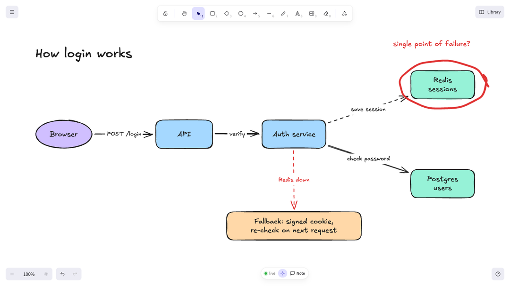
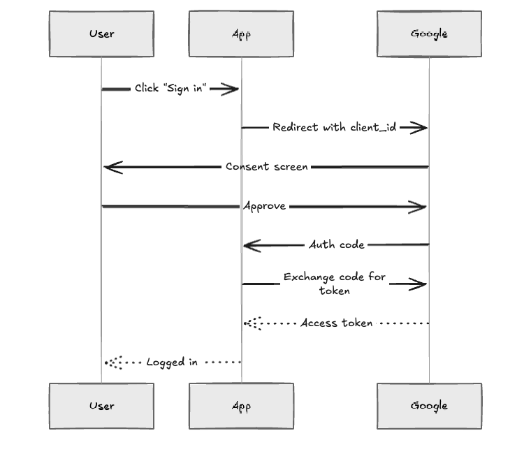

# Tools and how it works

## Tools

| Tool | What it does |
|---|---|
| `canvas_open` | Show this chat's board, give it a title, open another chat's board (this project first, then any folder), or load a saved copy |
| `canvas_draw` | Create or update shapes, text, labelled arrows bound to shapes, frames |
| `canvas_read` | Describe the board, plus what you changed and noted since the agent last looked |
| `canvas_focus` | Scroll your view to some elements and pulse a highlight around them |
| `canvas_screenshot` | PNG of the board so the agent can check its layout |
| `canvas_mermaid` | Turn a Mermaid diagram into hand-drawn elements |
| `canvas_delete` | Delete elements, or clear the board |
| `canvas_export` | Save the board as `.excalidraw` or `.png` in your project |
| `canvas_save` | Save a frozen copy of the board to your library, so later chats can find it |
| `canvas_search` | Find other chats' boards and saved copies, in every folder, by name or the text on them |
| `canvas_guide` | Short guide for the agent on explaining well (layout, colours, sizes) |

Every tool result also tells the agent when you've changed something since its last `canvas_read`.

## When you draw back

It's your board too. Circle something, scribble a question, move a box, or press **Note** to send a message. On its next look the agent gets a short list of exactly what you changed:



```text
Human changes since your last read:
Added (2):
  freedraw "RSPj…" hand sketch (1345,193) 254×140 stroke #e03131
  text "2CLo…" "single point of failure?" (1090,92) stroke #e03131
```

> MCP can't interrupt the agent mid-turn, so after you draw, just tell it to "look at the board".

## Mermaid

For sequence diagrams and quick flowcharts the agent can write Mermaid and get an editable hand-drawn diagram:



## How it works

```
 you ◀──── chat ────▶ coding agent
  │                        │ MCP (stdio) or CLI
  │                        ▼
  │                whiteboard-mcp ── HTTP + token ──▶ canvas daemon (127.0.0.1)
  │                                                     │  JSON files on disk
  └──── draws / watches ◀──── WebSocket ──── Excalidraw viewer
```

Each agent session runs its own small MCP server. They all talk to one shared daemon on `127.0.0.1`, which stores boards as JSON and syncs them live with the [Excalidraw](https://github.com/excalidraw/excalidraw) viewer in your browser or editor.

## Light and local

- One runtime dependency (`ws`), no native addons, nothing to compile.
- A small shared background process serves every agent session and exits when idle.
- Everything stays on your machine: local-only server, token-protected, fonts bundled. Details in [security.md](security.md).
- Eleven compact tools, about 7 KB of schema per turn, so it barely touches your context window.
